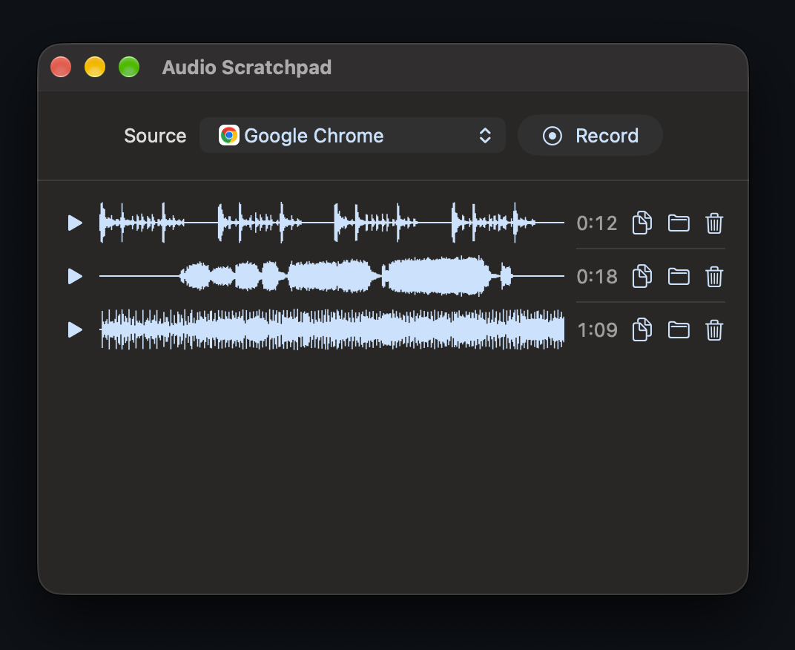

<div align="center">

# Audio Scratchpad

### Record the sound of one app, then play it back or drag it straight into another app.

**For Mac and Windows. No silence to trim, no quality lost, nothing else from your computer in the recording.**

[](https://github.com/felixxwu/audio-scratchpad/releases/latest)
[](https://github.com/felixxwu/audio-scratchpad/actions/workflows/release.yml)
[](#install)
[](LICENSE)

**[Download the latest release](https://github.com/felixxwu/audio-scratchpad/releases/latest)**

[Features](#features) · [Install](#install) · [Usage](#usage) · [Build from source](#build-from-source) · [Contributing](#contributing) · [Code signing policy](#code-signing-policy) · [License](#license)

<br />



</div>

---

## Features

- **Record one app:** capture a single app's audio without picking up the rest of your computer.
- **Start on the first sound:** recording begins at the first non-zero sample, so there's no silence to trim from the start.
- **Keep the full quality:** recordings are uncompressed 32-bit float WAV files at 48 kHz in stereo.
- **See every take:** each recording gets a waveform you can click or drag along to jump to any point.
- **Use it anywhere:** click the copy icon to copy the file, or drag the icon into another app.

## Install

| Platform | Requirements                      | Download                                                                               |
| -------- | --------------------------------- | -------------------------------------------------------------------------------------- |
| Mac      | Apple Silicon, macOS 14 or later  | [`.zip` from the latest release](https://github.com/felixxwu/audio-scratchpad/releases/latest) |
| Windows  | Windows 10 version 2004 or later  | [`.exe` from the latest release](https://github.com/felixxwu/audio-scratchpad/releases/latest) |

### Mac

1. Unzip the download and move **Audio Scratchpad** to your Applications folder.
2. Open it. The app isn't notarized, so macOS will block it the first time. Go to **System Settings → Privacy & Security** and choose **Open Anyway**.
3. Allow **Screen & System Audio Recording** when asked. macOS uses this permission for app audio, and Audio Scratchpad doesn't save any video.

### Windows

Run the `.exe`. There's nothing to install. The app isn't signed, so Windows may warn you the first time. Choose **More info → Run anyway**.

### Web

There's also a [browser version](https://audio-scratchpad.web.app), with nothing to install. It works differently from the apps:

- **Browsers:** it needs desktop Chrome or Edge, because Firefox and Safari can't share sound.
- **Sources:** you choose from the browser's sharing popup each time. Sharing a tab records only that tab. Sharing a window or your whole screen depends on what your browser and system allow.
- **Saving:** recordings stay in browser storage, and clearing your browsing data deletes them. Click the download icon to keep a copy, or drag it into another app.

## Usage

1. Open the app you want to record and choose it under **Source**.
2. Click **Record**. The button shows "waiting for audio..." until the app makes a sound.
3. Click **Stop** when you're done, and the recording appears in the list.

Recordings are saved here:

| Platform | Folder                      |
| -------- | --------------------------- |
| Mac      | `~/Music/Audio Scratchpad`  |
| Windows  | `Music\Audio Scratchpad`    |

> [!NOTE]
> Only apps with a Dock icon or a window are listed, so apps that run only from the menu bar or system tray won't appear.

## Build from source

### Mac

You'll need the Xcode command line tools, which you can install with `xcode-select --install`.

```sh
mac/build.sh
open ~/Applications/"Audio Scratchpad.app"
```

The script runs the self-checks, builds the app and installs it to `~/Applications`.

### Windows

You don't need to install anything, because the script uses the compiler that comes with Windows.

```bat
windows\build.cmd
"build\Audio Scratchpad.exe"
```

The script runs the self-checks and builds the app to `build`.

### Web

There's nothing to build. Serve the `web` folder from `localhost` or HTTPS, because browsers only allow capture and storage on secure addresses. `web/check.sh` runs the self-checks in Chrome.

## Contributing

Bug reports and pull requests are welcome. Every push to `main` and every pull request builds both apps and runs the self-checks for all three versions, so run the build script for your platform before opening a pull request.

Publishing a GitHub release does the same and attaches the apps to that release.

## Code signing policy

Current Windows releases are unsigned. This project is applying to [SignPath Foundation](https://signpath.org) for free code signing, and this policy applies once it's approved:

Free code signing provided by [SignPath.io](https://about.signpath.io), certificate by [SignPath Foundation](https://signpath.org).

**Team roles**

- Committers and reviewers: [Felix Wu](https://github.com/felixxwu)
- Approvers: [Felix Wu](https://github.com/felixxwu)

**Privacy policy**

This program will not transfer any information to other networked systems unless specifically requested by the user or the person installing or operating it.

## License

[MIT](LICENSE)
